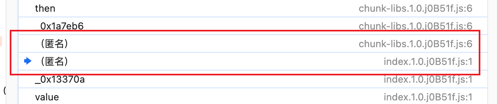

# yxai.189.cn 瑞数6逆向
 - ts.js 是加密数据 vm js代码
 - iBlPiBtflxq4.81fbd34.js 是解密
 - env.js 补环境
 - main.js 是主程序 （编写逆向）

# 虚假数据
张三
110101198503127890
13900071234
花园3号楼202室

# chunk-libs.1.0.jB51f.js
_0x5af58d['send'](_0xbfd9d8) // 这里的 _0xbfd9d8 就是post的data加密数据

数据加密位置如下

# 滑块验证码
https://yxai.189.cn/bloc/actApi/code/captcha
payload=5GrWahwoeKxVRkCyIqPLwjjycxNa/gVp9OPea4/93g4=

